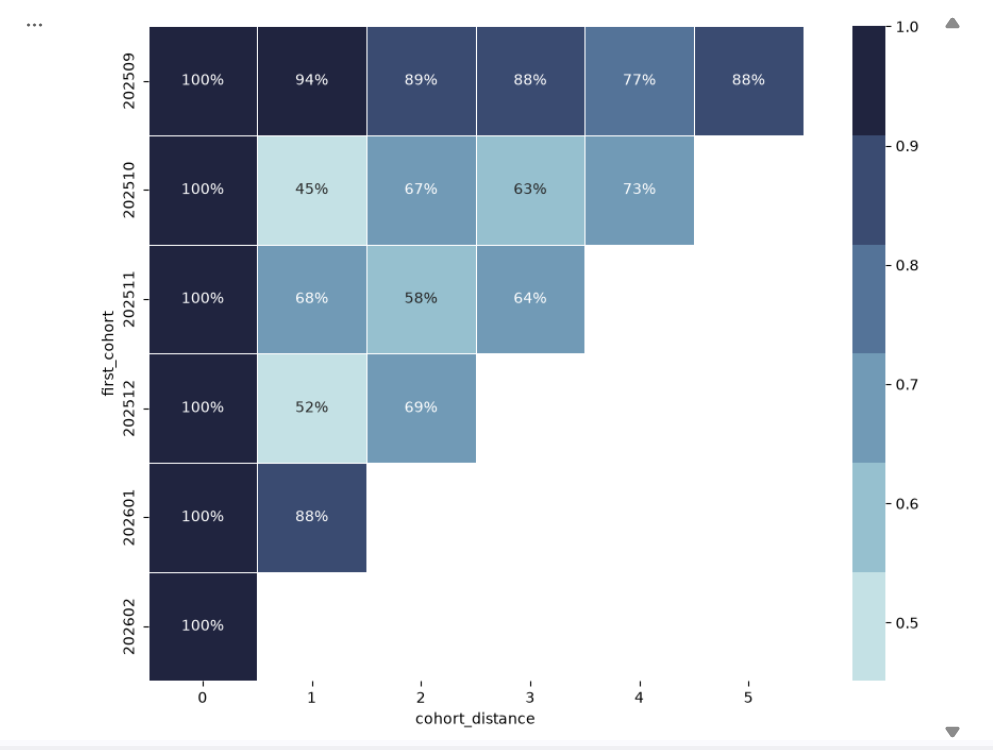

# Customer Retention Analysis – MSME Laundry Services

## 1. Project Overview

**Industry:** MSME – Laundry Services

A business intelligence project analyzing customer transaction data from a laundry service business located near a university campus. The business primarily serves university students living in nearby boarding houses and residential areas.

**Role:** Business Intelligence Analyst

Transformed daily operational transaction data from **September 2025 to February 2026** into actionable business insights through customer cohort analysis.

**Objective:** Customer Retention Analysis using Cohort Analysis

In the laundry service industry, repeat transactions are essential to sustainable revenue. Understanding customer retention patterns helps businesses evaluate customer loyalty, identify customer drop-off periods, and develop strategies to improve customer lifetime value (CLV).

This project focuses on understanding how customer retention changes over time, particularly around university academic and holiday periods.

## 2. Methodology

The analysis was conducted through four main stages:

**1. Raw Transaction Data Preparation**
- Extracted transaction dates and customer identifiers.
- Parsed UTC timestamps into standardized datetime features.
- Organized transaction records into monthly periods.

**2. Cohort Formation**
- Identified each customer's first transaction month.
- Assigned customers to acquisition cohorts.
- Calculated relative month indices to track customer activity over time.

**3. Retention Calculation**
- Counted unique active customers within each cohort and monthly period.
- Calculated monthly retention rates relative to each cohort's initial month (Month 0).
- Organized the results into a cohort retention matrix.

**4. Data Visualization**
- Created an annotated cohort retention heatmap using Python and Seaborn.
- Visualized customer retention patterns and identified periods of significant customer drop-off.

## 3. Key Findings & Business Implications

### Key Finding: Customer Acquisition Decline During the University Holiday Period



New customer acquisition declined significantly toward the end of the observation period:

| Month | New Customers |
|---|---:|
| November 2025 | 53 |
| December 2025 | 29 |
| January 2026 | 8 |
| February 2026 | 7 |

The decline continued from November through February, with January and February recording the lowest monthly acquisition figures.

Furthermore, cohorts acquired before the holiday period, particularly October and November, experienced their lowest retention during the subsequent months.

### Business Implication: Academic Calendar-Driven Customer Behavior

Located near a major university campus, the laundry business primarily serves students living in nearby boarding houses and residential areas.

Consequently, its customer activity may be strongly influenced by university schedules. Academic breaks can reduce the number of students staying near campus, potentially affecting both new customer acquisition and repeat transactions.

This creates a business challenge: customer activity and revenue may fluctuate between academic terms and holiday periods.

### Strategic Considerations

Based on these findings, several business strategies can be considered:

- **Retention Programs:** Develop targeted incentives to encourage existing customers to return, particularly before and during academic breaks.
- **Seasonal Planning:** Adjust operational and marketing plans to anticipate fluctuations in customer demand.
- **Customer Reactivation:** Identify inactive customers and design targeted campaigns to encourage repeat transactions.

*Note: These are strategic recommendations derived from observed transaction patterns. Their actual impact requires further implementation and evaluation.*

## 4. Tools & Technologies

- Python
- Pandas
- Seaborn
- Matplotlib
- Jupyter Notebook

## 5. Project Structure

```text
user-retention-analysis/
│
├── data/
│   └── rekapitulasi_transaksi_irlo.xlsx
│
├── docs/
│   └── Project LO I - User Retention.pdf
│
├── notebooks/
│   └── LO_Project1.ipynb
│
├── outputs/
│   └── retention-chart.png
│
└── README.md
```

## 6. Project Scope

- **Business Domain:** MSME Laundry Services
- **Analysis Period:** September 2025 – February 2026
- **Primary Analysis:** Customer Cohort Analysis
- **Business Focus:** Customer Retention, Acquisition Trends, and Seasonal Demand Patterns

---

*This project uses anonymized business transaction data for analytical and portfolio purposes.*
